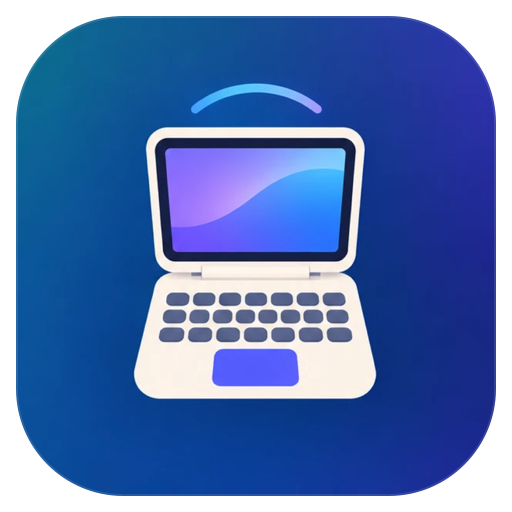
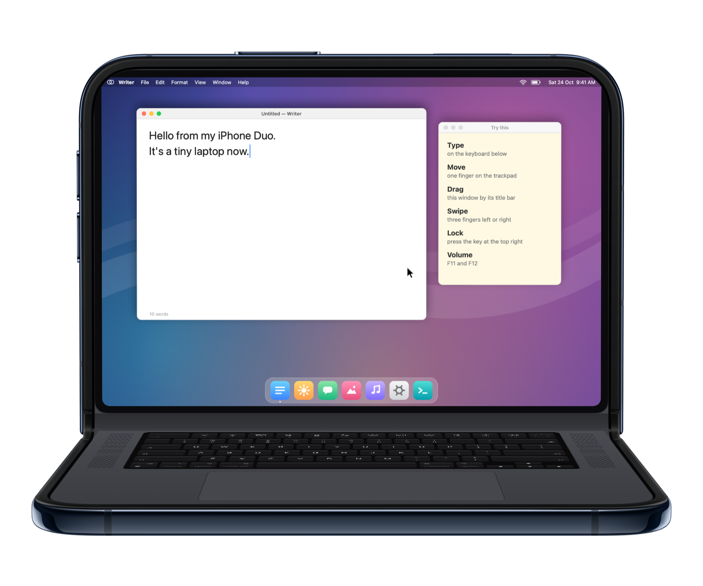
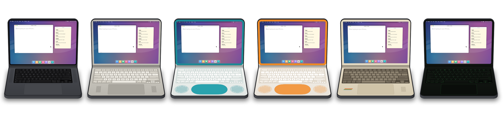

<p align="center">
  
</p>

<h1 align="center">DuoBook</h1>

<p align="center"><b>Your iPhone Duo is a laptop now.</b></p>

<p align="center">
  <a href="https://mehdichitsaz.github.io/duobook/">Website</a> ·
  <a href="https://mehdichitsaz.github.io/duobook/mac/">Get DuoBook Host for Mac</a> ·
  <a href="https://mehdichitsaz.github.io/duobook/support/">Support</a> ·
  <a href="https://mehdichitsaz.github.io/duobook/privacy/">Privacy</a> ·
  <a href="https://www.instagram.com/duobook.app/">Instagram</a>
</p>

<p align="center">
  
</p>

DuoBook turns iPhone Duo into a tiny laptop for your Mac. Fold it like a laptop: the top half shows your Mac’s screen, live, and the bottom half is a full keyboard and trackpad that control it, at home or from anywhere.

**Coming soon to the App Store.** Follow [@duobook.app](https://www.instagram.com/duobook.app/) for launch day.

This repository is the source of the DuoBook website.

## Features

- **Every key you know.** A full Mac keyboard with the top row for brightness, Mission Control, Spotlight, media, and volume. Hold ⌘ ⌥ ⌃ while you type, or tap to latch them. The Touch ID key locks your Mac.
- **Real key sounds.** Every theme has its own click sound, with haptics.
- **A real trackpad.** Tap to click, two-finger tap to right-click, scroll with momentum, pinch to zoom, and swipe three fingers to switch desktops.
- **Your Mac, anywhere.** At home it finds your Mac on Wi-Fi. Away, it reaches it over the internet. There’s no account to create.
- **Encrypted end to end.** Pair once with a 6-digit code shown on both screens. Every connection after that is encrypted.
- **A lid that feels real.** Closed, the outer screen is your laptop’s lid. Pick its color, finish, and logo.
- **Six looks.** From today’s black keys to a teal clamshell, office platinum, 80s beige, and a green-screen terminal.
- **Built-in demo.** No Mac nearby? Try DuoBook with a demo Mac right in the app.

<p align="center">
  
</p>

## Requirements

- iPhone Duo, or any iPhone with iOS 17 or later
- A Mac with macOS 14 Sonoma or later (Apple silicon or Intel)
- **DuoBook Host**, the free menu-bar app for Mac, signed and notarized by Apple

## Get started

1. [Download DuoBook Host](https://mehdichitsaz.github.io/duobook/mac/), open the file, and drag DuoBook Host to Applications.
2. Open it, then click **Allow** for Screen Recording and Accessibility when it asks.
3. Open DuoBook on your iPhone, tap your Mac, check that the code matches on both screens, and click **Pair**.
4. Open your iPhone Duo like a laptop and start typing.

To use your Mac away from home, turn on **Access from anywhere** in DuoBook Host.

## Privacy

DuoBook doesn’t collect any data. There are no accounts, analytics, or ads, and no server ever sees your screen. Your screen and input travel encrypted between your own devices, and your Mac’s address is kept in your own private iCloud. Read the full [privacy policy](https://mehdichitsaz.github.io/duobook/privacy/).

## About this repository

The website is plain HTML and CSS, served by GitHub Pages from the `main` branch.

| Path | What it is |
|---|---|
| `index.html` | Home page |
| `mac/` | DuoBook Host download and setup page |
| `support/` | Help and frequently asked questions |
| `privacy/` | Privacy policy |
| `assets/` | Images and icons |
| `downloads/DuoBook-Host.dmg` | The signed, notarized Mac app |
| `styles.css` | Styles for every page |
| `.nojekyll` | Tells GitHub Pages to serve the files as they are |

To preview the site on your Mac, run this in the repository folder, then open http://localhost:8000:

```bash
python3 -m http.server 8000
```

Push to `main` to publish. The live site updates within a few minutes.

## Contact

Questions or feedback: [chitsaz.mehdi77@gmail.com](mailto:chitsaz.mehdi77@gmail.com) or [@duobook.app](https://www.instagram.com/duobook.app/) on Instagram.

## Legal

© 2026 Mehdi Chitsaz. All rights reserved. The device images use Apple’s product bezels and may not be reused.

DuoBook is not affiliated with Apple. iPhone, iPhone Duo, Mac, MacBook, and Touch ID are trademarks of Apple Inc., registered in the U.S. and other countries.
